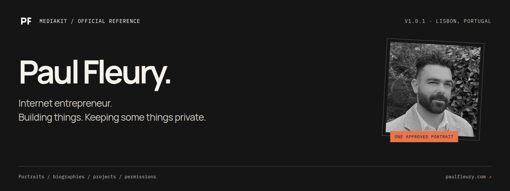
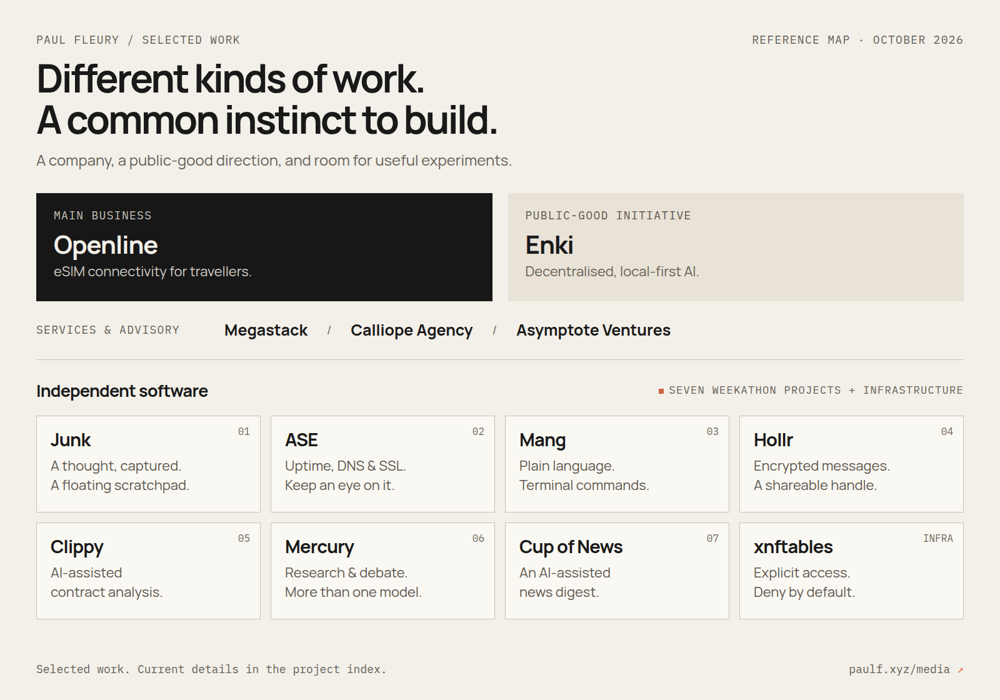

# Paul Fleury · "Media Kit"

<p align="center">
  
</p>

<p align="center">
  
</p>

<p align="center">
  <a href="https://github.com/paulfxyz/mediakit/releases/latest"></a>
  <a href="LICENSE"></a>
  <a href="LICENSES/MIT.txt"></a>
  <a href="docs/PORTRAIT.md"></a>
  <a href="https://github.com/paulfxyz/mediakit/actions/workflows/validate.yml"></a>
</p>

<p align="center">
  <a href="docs/PORTRAIT.md">Portraits</a> ·
  <a href="docs/BIOGRAPHIES.md">Biographies</a> ·
  <a href="docs/PROJECTS.md">Projects</a> ·
  <a href="docs/BRAND.md">Graphics &amp; marks</a> ·
  <a href="LICENSE">Usage &amp; permissions</a>
</p>

**One portrait. Useful context. Clear boundaries.** This is my official media kit: the image I authorise for public reuse, copy-ready biographies, a map of my work, and the permissions that go with them.

[Website](https://paulfleury.com) · [LinkedIn / contact](https://www.linkedin.com/in/paulfxyz/) · [Weekathon](https://ph.paulfleury.com) · [Download the media pack](https://github.com/paulfxyz/mediakit/releases/latest)

For a short, shareable address, use [paulf.xyz/media](https://paulf.xyz/media). The repository is the detailed reference; the short link is the convenient way to pass it on.

## Quick start

- **Writing about me?** Start with the [copy-ready biographies](docs/BIOGRAPHIES.md) and [life and work](docs/LIFE-AND-WORK.md).
- **Need a picture?** Use the [approved portrait](assets/portrait/paul-fleury-square-512.jpg), not an image found elsewhere. Read the [portrait guide](docs/PORTRAIT.md) and [media permission](LICENSE) first.
- **Covering a project?** Consult the [project index](docs/PROJECTS.md); each product has its own website and licensing.
- **Looking for personal context?** Read [a note on privacy, health, and public presence](docs/PERSONAL-STATEMENT.md), in my own voice.
- **Need a different use?** Please [contact me on LinkedIn](https://www.linkedin.com/in/paulfxyz/) before advertising, endorsements, substantial image edits, or other uses outside the permission.

## The person

I am a French internet entrepreneur based in Lisbon, with Openline as my main business and work spanning connectivity, cybersecurity, AI, and independent products ([professional profile](https://www.linkedin.com/in/paulfxyz/)). My public portfolio combines ventures, open-source tools, and quieter experiments ([personal website](https://paulfleury.com)).

Over the past 15 years, I have lived in at least a dozen countries, with a minimum of six months in each of the places listed in my [life-and-work account](docs/LIFE-AND-WORK.md). I genuinely enjoyed living in all of them; each city, region, and country was special and enriching in its own way. The list is deliberately not a timeline, and I keep exact dates and lengths of stay out of the public account.

I want the work to be visible without making my entire private life public. A small public footprint is a boundary, not a lack of interest in people or collaboration.

The biographies offer several levels of detail, from a one-line introduction to a fuller personal and professional profile. Choose the version that fits the story rather than treating every available detail as something that must be included.

## One portrait, deliberately modest

<p>
  
</p>

**This is the only photograph of myself I authorise for public reuse.** Every portrait file in this repository is a size, format, or crop of that same approved image, not another photograph.

Other avatars or images may turn up online; finding them does not make them authorised. The kit contains no video, alternate face, high-resolution original, or permission to synthesise one.

| Version | Dimensions | Formats | Intended use |
|---|---|---|---|
| Square | 128 × 128 | PNG, JPEG, WebP | Small author bylines |
| Square | 256 × 256 | PNG, JPEG, WebP | Profiles and article cards |
| Square | 512 × 512 | PNG, JPEG, WebP | Largest authorised portrait export |
| Circle | 256 × 256; 512 × 512 | PNG, WebP with transparency | Round profile layouts |
| Editorial crop | 400 × 500 | PNG, JPEG, WebP | Compact 4:5 article portrait |

Browse [all portrait files](assets/portrait/) or use the [format-by-format download table](docs/PORTRAIT.md). The portrait is intentionally capped at 512 pixels on its longest edge; please do not upscale, enhance, reconstruct, or request a more detailed face.

## The work



The [Weekathon](https://ph.paulfleury.com) brings together seven AI-assisted products as a public learning and launch experiment, not a claim that seven complete products were built from scratch in seven days. Its argument is about useful tools, ownership, costs, testing, and what happens after shipping ([campaign](https://ph.paulfleury.com)).

The [project index](docs/PROJECTS.md) separates my main business, services and advisory work, public-good work, independent tools, and earlier ventures. Product availability, release status, and commercial terms belong to the individual projects, not to this media kit.

What connects these projects is a practical interest in useful tools and the work that comes after an idea. An experiment can be worthwhile without becoming a company, and a launch is a starting point for testing and maintenance rather than proof that everything is finished.

## Personal context, without speculation

I live with agoraphobia and claustrophobia, among other things I prefer to keep private. I am also a bit of a control freak and very privacy-conscious; the [short personal statement](docs/PERSONAL-STATEMENT.md) explains why I keep my public presence bounded.

My position on a more public life is not fixed forever. For now, sharing projects and bounded experiments is the balance I choose.

## What's in the package

```text
mediakit/
├── README.md
├── LICENSE                         Limited permission for media and identity
├── LICENSES/MIT.txt                 Build tooling only
├── docs/
│   ├── BIOGRAPHIES.md               One-line, short, and extended bios
│   ├── LIFE-AND-WORK.md             Background and working philosophy
│   ├── PROJECTS.md                  Curated, linked project index
│   ├── PERSONAL-STATEMENT.md        Privacy, health, and public presence
│   ├── PORTRAIT.md                  Portrait formats and usage
│   ├── BRAND.md                    Graphics, marks, and attribution
│   ├── MEDIA-GUIDE.md               Reporting, contact, and interview notes
│   └── MAINTAINING.md               Rebuild and release instructions
├── assets/
│   ├── portrait/                   Only the approved, downsampled portrait
│   ├── brand/                      PF marks and application-style icons
│   ├── graphics/                   Header, project map, and social card
│   └── manifest.json               Dimensions, file sizes, and SHA-256 hashes
├── data/
│   ├── profile.json                Public professional facts, no health fields
│   └── projects.json               Public project links and descriptions
├── scripts/                        Reproducible exports and validation
├── package.json                    Asset build tooling; not an npm product
└── .github/workflows/validate.yml   Asset, privacy, and link checks
```

The [release ZIP](https://github.com/paulfxyz/mediakit/releases/latest) contains the public documents, data, graphics, portrait exports, and applicable licenses. The original portrait is not part of the repository, its history, or the release package.

## Rights, not a blanket open-source license

- **Portrait, words, graphics, and identity:** Rights are reserved, with a limited permission for attributed editorial and biographical use under [LICENSE](LICENSE).
- **Build code:** `scripts/` and the validation workflow are MIT-licensed under [LICENSES/MIT.txt](LICENSES/MIT.txt). That does not license the person or the generated assets.
- **Other projects:** Linking a project here does not change that project's license, ownership, availability, or terms.
- **Public does not mean private later:** GitHub permits viewing and forking public repositories through its service; those copies may persist after the original changes ([GitHub terms](https://docs.github.com/en/site-policy/github-terms/github-terms-of-service)).

This is not a public-domain dedication or a Creative Commons release of my likeness. Lawful exceptions, independent reporting, criticism, and GitHub's own platform rights remain unaffected.

## Rebuild and verify

```sh
git clone https://github.com/paulfxyz/mediakit.git
cd mediakit
npm ci
npm test
npx playwright install chromium
npm run build
npm run pack
```

No API key or AI service is required to rebuild the assets. See [maintenance instructions](docs/MAINTAINING.md) for the distinction between rebuilding the public exports and importing a newly approved original.

## Corrections and contact

Please use [GitHub issues](https://github.com/paulfxyz/mediakit/issues) for broken links or file problems and [LinkedIn](https://www.linkedin.com/in/paulfxyz/) for media enquiries and permission requests. Do not post private photographs, medical information, personal correspondence, or other people's personal data in an issue.

Content snapshot: 12 October 2026. This kit is a maintained reference, not a complete CV, a medical record, or a live statement of every project's status.
